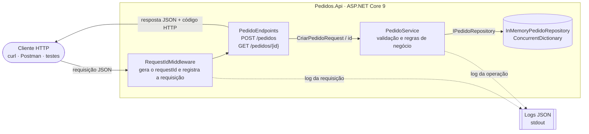
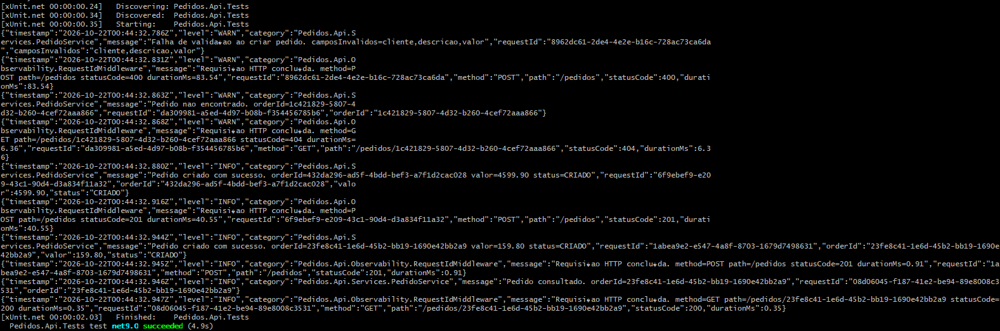

# CP5 – Arquitetura Orientada a Serviço · API de Pedidos

API REST simples para gerenciamento de pedidos de um e-commerce: **criar um pedido** e **consultar um pedido por identificador**, com armazenamento em memória, documentação OpenAPI, teste automatizado e logs estruturados em JSON.

FIAP · 3ESPY · 2026 · Profa. Damiana Costa

## Integrantes

| Nome | RM |
|------|----|
| Ana Clara Melo | 559021 |
| David Murillo de Oliveira Soares | 559078 |
| Lucas Serrano | 555170 |
| Yasmin Gonçalves Coelho | 559147 |

## Linguagem e framework

- **Linguagem:** C# 13
- **Framework:** .NET 9 / ASP.NET Core 9 (Minimal APIs)
- **Persistência:** em memória (`ConcurrentDictionary`), sem banco externo
- **Testes:** xUnit + `Microsoft.AspNetCore.Mvc.Testing` (`dotnet test`) e coleção Postman executada via Newman
- **Logs:** formatter JSON próprio sobre o `Microsoft.Extensions.Logging` (sem bibliotecas externas)

A API não usa nenhum pacote NuGet além do próprio ASP.NET Core.

## Estrutura do repositório

```
├── Pedidos.sln
├── docs/
│   ├── openapi.yaml                  # especificação OpenAPI 3.0
│   └── evidencias/                   # saída real dos testes e dos logs
├── src/Pedidos.Api/
│   ├── Program.cs                    # composição: DI, JSON, ProblemDetails, logs, rotas
│   ├── Endpoints/PedidoEndpoints.cs  # entrada HTTP
│   ├── Services/PedidoService.cs     # lógica de negócio e validação
│   ├── Repositories/                 # armazenamento em memória
│   ├── Domain/                       # entidade Pedido e StatusPedido
│   ├── Contracts/                    # DTOs de requisição e resposta
│   └── Observability/                # requestId e formatter de log JSON
└── tests/
    ├── Pedidos.Api.Tests/            # testes de integração xUnit
    └── postman/                      # coleção Postman com scripts de teste
```

## 1. Arquitetura e System Design



O fluxo é em camadas, e cada camada só conhece a de baixo por meio de uma interface:

| Componente | Responsabilidade |
|---|---|
| **RequestIdMiddleware** | Primeiro ponto da requisição. Reaproveita o header `X-Request-Id` ou gera um novo, devolve esse id na resposta e o coloca no escopo de log. Ao final, registra método, caminho, status e duração. |
| **PedidoEndpoints** (entrada HTTP/API) | Define as rotas, recebe e devolve JSON e traduz o resultado do serviço em códigos HTTP (201, 200, 400, 404). Não tem regra de negócio. |
| **PedidoService** (lógica de negócio) | Valida os dados (cliente e descrição obrigatórios, valor > 0), gera id, status `CRIADO` e data de criação, persiste e registra logs das operações. |
| **InMemoryPedidoRepository** (armazenamento) | Guarda os pedidos num `ConcurrentDictionary` (seguro para acessos simultâneos). Implementa `IPedidoRepository`, então pode ser trocado por um banco real sem mudar o serviço. |
| **JsonLogFormatter** (observabilidade) | Escreve cada log como uma linha JSON com `timestamp`, `level`, `message`, `requestId` e dados como `orderId`. |

Erros seguem o padrão **ProblemDetails** (RFC 9457, `application/problem+json`), sempre com o `requestId` no corpo.

## 2. OpenAPI / Swagger

A especificação está em [`docs/openapi.yaml`](docs/openapi.yaml) (OpenAPI 3.0.3, validada). Para visualizar, abra o arquivo no [Swagger Editor](https://editor.swagger.io) (File → Import file).

| Operação | Método e caminho | Entrada | Respostas |
|---|---|---|---|
| Criar pedido | `POST /pedidos` | JSON com `cliente`, `descricao`, `valor` | `201` pedido criado (header `Location`) · `400` dados inválidos ou JSON malformado · `500` erro interno |
| Consultar pedido | `GET /pedidos/{id}` | `id` (UUID) no caminho | `200` pedido encontrado · `404` pedido inexistente · `500` erro interno |

## 3. Como executar a API

Pré-requisito: [.NET 9 SDK](https://dotnet.microsoft.com/download/dotnet/9.0).

```bash
git clone <URL_DO_REPOSITORIO>
cd <PASTA_DO_REPOSITORIO>
dotnet run --project src/Pedidos.Api
```

A API sobe em **http://localhost:5000** e os logs JSON aparecem no terminal.

### Exemplos de requisição e resposta

**Criar pedido – 201 Created**

```bash
curl -i -X POST http://localhost:5000/pedidos \
  -H "Content-Type: application/json" \
  -H "X-Request-Id: req-criar-001" \
  -d '{"cliente":"Maria Silva","descricao":"1x Notebook Dell Inspiron 15","valor":4599.90}'
```

```http
HTTP/1.1 201 Created
Content-Type: application/json; charset=utf-8
Location: /pedidos/904e15a1-9570-4f5b-a7b4-e360b3f8cab8
X-Request-Id: req-criar-001

{"id":"904e15a1-9570-4f5b-a7b4-e360b3f8cab8","cliente":"Maria Silva","descricao":"1x Notebook Dell Inspiron 15","valor":4599.90,"status":"CRIADO","criadoEm":"2026-10-22T00:33:35.6762143+00:00"}
```

**Consultar pedido existente – 200 OK** (use o `id` devolvido no POST; os dados ficam só na memória da execução atual)

```bash
curl -i http://localhost:5000/pedidos/904e15a1-9570-4f5b-a7b4-e360b3f8cab8 \
  -H "X-Request-Id: req-consulta-002"
```

```http
HTTP/1.1 200 OK
Content-Type: application/json; charset=utf-8
X-Request-Id: req-consulta-002

{"id":"904e15a1-9570-4f5b-a7b4-e360b3f8cab8","cliente":"Maria Silva","descricao":"1x Notebook Dell Inspiron 15","valor":4599.90,"status":"CRIADO","criadoEm":"2026-10-22T00:33:35.6762143+00:00"}
```

**Consultar pedido inexistente – 404 Not Found**

```bash
curl -i http://localhost:5000/pedidos/3fa85f64-5717-4562-b3fc-2c963f66afa6 \
  -H "X-Request-Id: req-inexistente-003"
```

```http
HTTP/1.1 404 Not Found
Content-Type: application/problem+json
X-Request-Id: req-inexistente-003

{"type":"https://tools.ietf.org/html/rfc9110#section-15.5.5","title":"Pedido não encontrado.","status":404,"detail":"Não existe pedido com o id 3fa85f64-5717-4562-b3fc-2c963f66afa6.","traceId":"00-0adbaebc3735bcf90389529b2c255ddc-162c16118ab350f7-00","requestId":"req-inexistente-003"}
```

**Criar pedido com dados inválidos – 400 Bad Request**

```bash
curl -i -X POST http://localhost:5000/pedidos \
  -H "Content-Type: application/json" \
  -H "X-Request-Id: req-invalido-004" \
  -d '{"cliente":"","valor":-10}'
```

```http
HTTP/1.1 400 Bad Request
Content-Type: application/problem+json
X-Request-Id: req-invalido-004

{"type":"https://tools.ietf.org/html/rfc9110#section-15.5.1","title":"Dados do pedido inválidos.","status":400,"errors":{"cliente":["O cliente é obrigatório."],"descricao":["A descrição é obrigatória."],"valor":["O valor deve ser maior que zero."]},"traceId":"00-785462c600d7eeead15ceec00bb968a7-c1742f36c0825cf7-00","requestId":"req-invalido-004"}
```

> O header `X-Request-Id` é opcional: sem ele, a API gera um UUID. No Windows (PowerShell), use `curl.exe` no lugar de `curl`, ou importe a coleção de `tests/postman` no Postman.

## 4. Teste automatizado

### Testes de integração xUnit

Arquivo: [`tests/Pedidos.Api.Tests/PedidosApiTests.cs`](tests/Pedidos.Api.Tests/PedidosApiTests.cs). Os testes sobem a API em memória com `WebApplicationFactory` e fazem chamadas HTTP reais, com verificações objetivas de status, headers e corpo:

| Teste | Verifica |
|---|---|
| `CriarPedido_ComDadosValidos_Retorna201ComPedidoCriado` | status 201, id gerado, dados gravados, status `CRIADO` e header `Location` |
| `ConsultarPedido_Existente_Retorna200ComOsMesmosDados` | status 200 e o mesmo pedido que foi criado |
| `ConsultarPedido_Inexistente_Retorna404` | status 404, `application/problem+json` e header `X-Request-Id` |
| `CriarPedido_ComDadosInvalidos_Retorna400ComErrosPorCampo` | status 400 com erro em `cliente`, `descricao` e `valor` |

Para executar, na raiz do repositório:

```bash
dotnet test
```

**Evidência da execução (`dotnet test`):**

```text
[xUnit.net 00:00:02.03]   Finished:    Pedidos.Api.Tests
  Pedidos.Api.Tests test net9.0 succeeded (4.9s)

Test summary: total: 4, failed: 0, succeeded: 4, skipped: 0, duration: 4.8s
Build succeeded in 102.0s
```

Print da execução, com os logs JSON gerados durante os testes:



### Coleção Postman executada via Newman

Arquivo: [`tests/postman/Pedidos.postman_collection.json`](tests/postman/Pedidos.postman_collection.json), com 3 requisições e 7 asserções (`pm.test`). Com a API rodando:

```bash
npx newman run tests/postman/Pedidos.postman_collection.json
```

Também roda pelo Postman: importe a coleção e use **Run collection**.

**Evidência da execução** (saída completa em [`docs/evidencias/newman-execucao.txt`](docs/evidencias/newman-execucao.txt)):

```text
→ Criar pedido
  POST http://localhost:5000/pedidos [201 Created, 455B, 160ms]
  ✓  Retorna 201 Created
  ✓  Pedido nasce com status CRIADO
  ✓  Header Location aponta para o pedido

→ Consultar pedido existente
  GET http://localhost:5000/pedidos/477d7b34-8115-45f8-a7c4-3e5b31a0491b [200 OK, 393B, 7ms]
  ✓  Retorna 200 OK
  ✓  Devolve o pedido criado

→ Consultar pedido inexistente
  GET http://localhost:5000/pedidos/3fa85f64-5717-4562-b3fc-2c963f66afa6 [404 Not Found, 504B, 22ms]
  ✓  Retorna 404 Not Found
  ✓  Erro no formato problem+json

┌─────────────────────────┬───────────────────┬──────────────────┐
│                         │          executed │           failed │
├─────────────────────────┼───────────────────┼──────────────────┤
│                requests │                 3 │                0 │
├─────────────────────────┼───────────────────┼──────────────────┤
│              assertions │                 7 │                0 │
└─────────────────────────┴───────────────────┴──────────────────┘
```

## 5. Observabilidade: logs estruturados

Cada evento vira **uma linha JSON** no console, sempre com os mesmos campos base:

| Campo | Conteúdo |
|---|---|
| `timestamp` | data e hora em UTC (ISO 8601) |
| `level` | `INFO`, `WARN` ou `ERROR` |
| `category` | classe que gerou o log |
| `message` | descrição da operação |
| `requestId` | id da requisição (o mesmo do header `X-Request-Id`) |
| `orderId`, `statusCode`, `durationMs`... | dados estruturados da operação |

Requisições com status 4xx são registradas como `WARN` e 5xx como `ERROR`. O `requestId` liga o log do serviço ao log da requisição HTTP, e o `orderId` identifica o pedido.

**Evidência** – logs reais gerados pela execução acima (arquivo completo em [`docs/evidencias/logs-execucao.jsonl`](docs/evidencias/logs-execucao.jsonl)):

```json
{"timestamp":"2026-10-21T21:55:38.563Z","level":"INFO","category":"Pedidos.Api.Services.PedidoService","message":"Pedido criado com sucesso. orderId=477d7b34-8115-45f8-a7c4-3e5b31a0491b valor=4599.90 status=CRIADO","requestId":"7328fb3d-c8d1-4a43-89e3-6243db3cad7f","orderId":"477d7b34-8115-45f8-a7c4-3e5b31a0491b","valor":4599.90,"status":"CRIADO"}
{"timestamp":"2026-10-21T21:55:38.592Z","level":"INFO","category":"Pedidos.Api.Observability.RequestIdMiddleware","message":"Requisição HTTP concluída. method=POST path=/pedidos statusCode=201 durationMs=36","requestId":"7328fb3d-c8d1-4a43-89e3-6243db3cad7f","method":"POST","path":"/pedidos","statusCode":201,"durationMs":36}
{"timestamp":"2026-10-21T21:55:38.647Z","level":"WARN","category":"Pedidos.Api.Services.PedidoService","message":"Pedido não encontrado. orderId=3fa85f64-5717-4562-b3fc-2c963f66afa6","requestId":"044b7735-3faa-4d3a-a099-d87741610826","orderId":"3fa85f64-5717-4562-b3fc-2c963f66afa6"}
{"timestamp":"2026-10-21T21:55:38.666Z","level":"WARN","category":"Pedidos.Api.Observability.RequestIdMiddleware","message":"Requisição HTTP concluída. method=GET path=/pedidos/3fa85f64-5717-4562-b3fc-2c963f66afa6 statusCode=404 durationMs=19.21","requestId":"044b7735-3faa-4d3a-a099-d87741610826","method":"GET","path":"/pedidos/3fa85f64-5717-4562-b3fc-2c963f66afa6","statusCode":404,"durationMs":19.21}
{"timestamp":"2026-10-21T21:55:38.705Z","level":"WARN","category":"Pedidos.Api.Services.PedidoService","message":"Falha de validação ao criar pedido. camposInvalidos=cliente,descricao,valor","requestId":"req-invalido-004","camposInvalidos":"cliente,descricao,valor"}
```

Formatado, o primeiro registro fica assim:

```json
{
  "timestamp": "2026-10-21T21:55:38.563Z",
  "level": "INFO",
  "category": "Pedidos.Api.Services.PedidoService",
  "message": "Pedido criado com sucesso. orderId=477d7b34-8115-45f8-a7c4-3e5b31a0491b valor=4599.90 status=CRIADO",
  "requestId": "7328fb3d-c8d1-4a43-89e3-6243db3cad7f",
  "orderId": "477d7b34-8115-45f8-a7c4-3e5b31a0491b",
  "valor": 4599.90,
  "status": "CRIADO"
}
```

